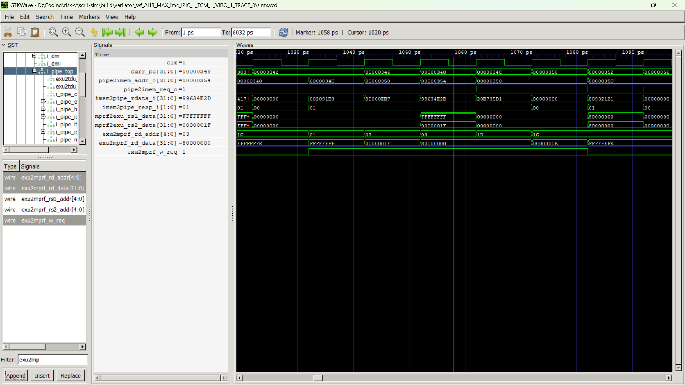
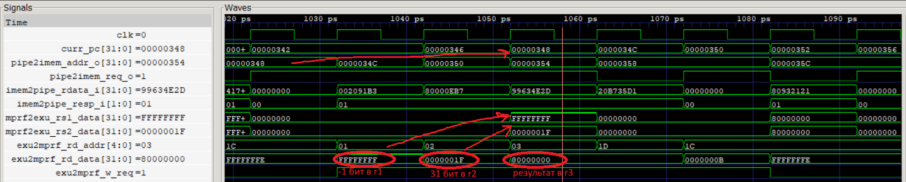

Вариант 10 
sll, вывод PC

Для запуска был создан docker container
```
docker run --rm -it --mount "type=bind,source=$($PWD.Path),target=/work" scr1-lab bash
```


Чтобы запустить тест нужно
```
make TARGETS=riscv_isa rv32_isa_tests=isa/rv32ui/sll.S
```

Сам тест можно найти в `dependencies/riscv-tests/isa/rv32ui/sll.S`

А список запускаемых тестов по умолчанию находится в `sim/tests/riscv_isa/rv32_tests.inc`

В make уже готов run_verilator_wf, который сохраняет и временные диаграммы

```
make run_verilator_wf TARGETS=riscv_isa rv32_isa_tests=isa/rv32ui/sll.S
```




Например, для проверка 11 из теста на sll 
```
TEST_RR_OP(11, sll, 0xffffffff80000000, 0xffffffffffffffff, 31);
```

В sll.dump видно адрес инструкции, откуда начинается тест

```
00000342 <test_11>:
 342:	fff00093          	li	ra,-1
 346:	417d                	li	sp,31
 348:	002091b3          	sll	gp,ra,sp
 34c:	80000eb7          	lui	t4,0x80000
 350:	4e2d                	li	t3,11
 352:	35d19963          	bne	gp,t4,6a4 <fail>
```


| Сигнал | Описание |
|---|---|
| clk | Тактовый сигнал |
| curr_pc | Адрес текущей инструкции |
| pipe2imem_req_o | Запрос чтения инструкции |
| pipe2imem_addr_o | Адрес чтения |
| imem2pipe_req_ack_i | Подтверждение приёма запроса (req = 1 и ack = 1) |
| imem2pipe_resp_i | Статус ответа: 0 - ожидание, 1 - успех, 2 - ошибка |
| imem2pipe_rdata_i | Код считанной инструкции |
| exu2mprf_rs1_addr | Номер регистра rs1 |
| mprf2exu_rs1_data | Значение rs1 |
| exu2mprf_rs2_addr | Номер регистра rs2 |
| mprf2exu_rs2_data | Значение rs2 |
| exu2mprf_w_req | Разрешение записи результата |
| exu2mprf_rd_addr | Номер регистра назначения rd |
| exu2mprf_rd_data | Значение для записи в rd |


| Сигнал | Значение | Описание |
|---|---|---|
| curr_pc | 00000348 | Выполняется sll |
| exu2mprf_rs1_addr | 1 | Читается регистр x1 |
| mprf2exu_rs1_data | ffffffff | Число для сдвига |
| exu2mprf_rs2_addr | 2 | Читается регистр x2 |
| mprf2exu_rs2_data | 0000001f | Сдвиг на 31 бит |
| exu2mprf_w_req | 1 | Запись результата разрешена |
| exu2mprf_rd_addr | 3 | Записываем в x3 |
| exu2mprf_rd_data | 80000000 | Полученный результат |





Сначала в x1 записывается ffffffff, затем в x2 - 31. Блок выборки заранее запрашивает инструкцию по адресу 0x348 и получает её машинный код 002091b3. Когда curr_pc принимает значение 0x348, на входах выполнения присутствуют подготовленные операнды. При активном exu2mprf_w_req результат 80000000 записывается в x3 на нарастающем фронте clk. Следующие команды сравнивают результат с эталоном.

Для обнаружения команды в `src/tb/scr1_top_tb_ahb.sv` добавлен несинтезируемый блок наблюдения:

```systemverilog
always @(posedge clk) begin
    if (i_top.i_core_top.i_pipe_top.exu2mprf_w_req &&
        i_top.i_core_top.i_pipe_top.i_pipe_exu.exu_queue.ialu_cmd
            == SCR1_IALU_CMD_SLL &&
        i_top.i_core_top.i_pipe_top.i_pipe_exu.exu_queue.ialu_op
            == SCR1_IALU_OP_REG_REG) begin
        $display("SLL: PC=%08h, rs1_data=%08h, rs2_data=%08h, result=%08h",
            i_top.i_core_top.i_pipe_top.curr_pc,
            i_top.i_core_top.i_pipe_top.mprf2exu_rs1_data,
            i_top.i_core_top.i_pipe_top.mprf2exu_rs2_data,
            i_top.i_core_top.i_pipe_top.exu2mprf_rd_data);
    end
end
```

Блок выполняется на каждом нарастающем фронте `clk`. Условие `exu2mprf_w_req` подтверждает, что действительная инструкция дошла до записи результата, поэтому сохранённый код операции при простое не вызывает лишний вывод. Проверка `ialu_cmd == SCR1_IALU_CMD_SLL` выбирает сдвиг влево, а `ialu_op == SCR1_IALU_OP_REG_REG` требует два регистровых операнда и отличает `sll` от `slli`. При выполнении всех условий `$display` выводит PC текущей команды, оба операнда и результат в шестнадцатеричном виде; `%08h` задаёт ширину поля не менее восьми цифр с дополнением нулями.

```
scr1_top_tb_ahb
---Test:                          sll.hex
...
SLL: PC=00000348, rs1_data=ffffffff, rs2_data=0000001f, result=80000000
...
Test passed

#--------------------------------------
# Summary: 1/1 tests passed
#--------------------------------------

- /work/src/tb/scr1_top_tb_runtests.sv:199: Verilog $finish
Simulation performed on Verilator 5.052 2026-09-05 rev v5.052 
                          Test               | build | simulation 
                         sll.hex                OK        PASS 
```
